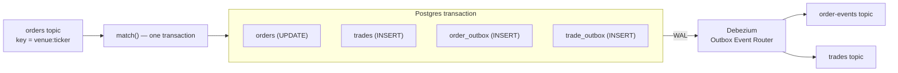

# Outbox, Postgres and Debezium

Every state change writes an event row in the **same database transaction** as the change itself.

[Debezium](https://debezium.io) reads those rows from the `PostgreSQL` write-ahead log and publishes them to `Kafka`.

An event exists if and only if the change committed.



## Tables

Both tables are append-only (every column is `updatable = false`).

They use the column names expected by Debezium's `EventRouter`.

| Column | `order_outbox` | `trade_outbox` |
|---|---|---|
| `id` | event id (UUID) — consumers de-duplicate on it | same |
| `aggregatetype` | `ORDER` | `TRADE` |
| `aggregateid` | instrument key `venue:ticker` → Kafka key | same |
| `type` | `NEW`, `FILL`, `CANCELLED`, `EXPIRED` | `TRADE_EXECUTED` |
| `payload` | `jsonb` `OrderEventDTO` (type, order snapshot, trade info for fills) | `jsonb` `TradeDTO` |
| extras | `order_id`, `trade_id`, `created_at` | `trade_id`, `created_at` |

A trade produces **one** `trade_outbox` row and **two** `FILL` rows in `order_outbox` (one per side).

Cancelling or expiring an order keeps whatever was already executed; the event carries the final `filledQuantity`.

Because the tables are never updated or purged by the application they double as the audit trail.

## Running it locally

```bash
docker compose up -d                   # redpanda, postgres (wal_level=logical), debezium-connect on :8084
mvn -pl stock-exchange spring-boot:run # creates the tables on startup (ddl-auto: update)
infra/debezium/register.sh             # registers both connectors (needs the tables to exist)
```

Connector definitions live in `infra/debezium/`.
Topics: `order-events` and `trades`, keyed by `venue:ticker`.

## Delivery guarantees

* **Outbox → Kafka is at-least-once.** After a Connect restart some events can be delivered twice, so consumers must be idempotent;
  * `live-market` ignores trades whose id it has seen recently;
* **Kafka → engine is at-least-once too.** Orders carry their id from `submit`; `match()` ignores an order id that is already stored;
* The replication slots (`order_outbox_slot`, `trade_outbox_slot`) retain WAL while Connect is down; monitor them in anything longer-lived than local development.

## Tests

Database tests run against a real `PostgreSQL` started by `Testcontainers` (`PostgresTestSupport`), so `Docker` must be available.
With `Colima/Docker Desktop` on a non-default socket export `DOCKER_HOST` (and, for Colima, `TESTCONTAINERS_DOCKER_SOCKET_OVERRIDE=/var/run/docker.sock`).
Docker Engine 29+ needs Testcontainers 1.21.4 or newer.

The Debezium connectors themselves are not exercised by the automated tests; they are verified manually with the compose stack.
